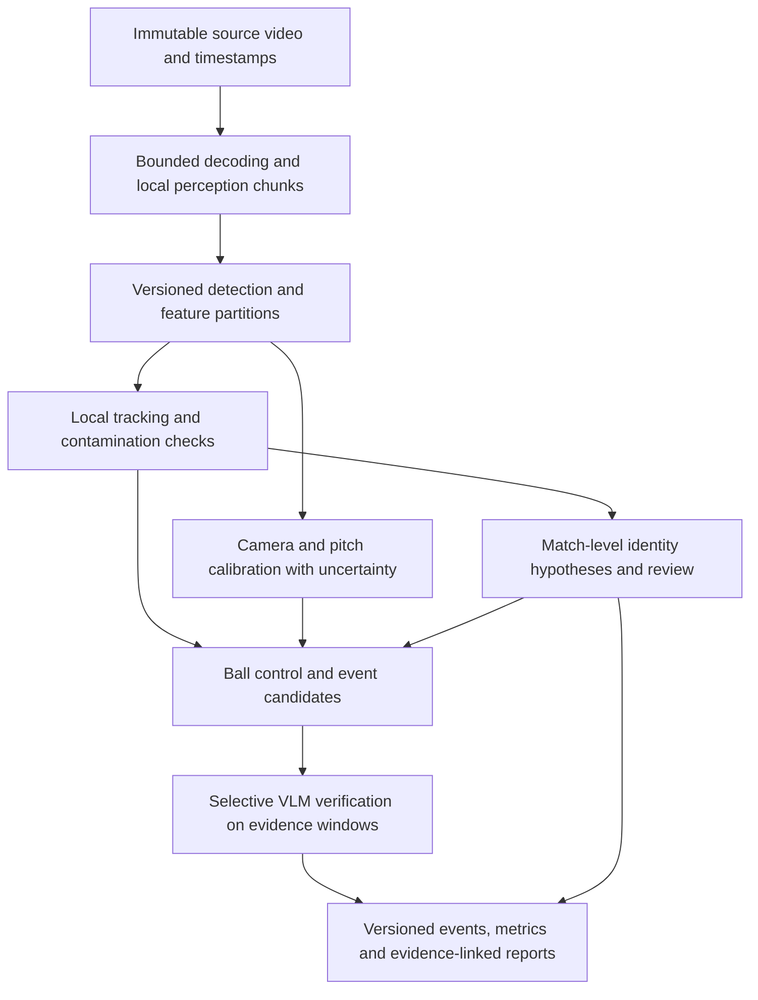

# F. Architecture Research for 90+ Minute Matches
**No long-video experiment was executed.** This document distinguishes visible mechanisms from unverified reliability and proposes an architecture to evaluate.

## 1. A frame loop is not a complete long-video architecture
Streaming compressed input prevents loading every decoded image at once. It does not automatically bound crop galleries, feature tables, trajectory histories, exported JSON, or VLM caches. A useful arithmetic reference: 90 minutes at 25 fps is 135,000 frames; one 1920×1080 RGB uint8 frame is 6,220,800 bytes. Retaining all such frames would be approximately 840 GB in decimal units. This is a storage calculation, not a benchmark.

AgentCoach prefetches/batches frames but collects full-range player crops before batched feature extraction. acato captures a complete JPEG-pipe output for a sampled range. These can be sensible for clips or sparse samples while still needing a bounded-range design for long recordings. [A-tracking] [C-frames]

## 2. What each system actually provides

| Project | Decode / persistence | Reuse and recovery | Identity continuity limit |
|---|---|---|---|
| AgentCoach | OpenCV/prefetch/batches; match-wide crops, detections/features/tracks; JSON/pickle artifacts | Stage `skip_existing`; no verified exact mid-tracker restart | Offline consolidation within processed range; no generic chunk-global contract [A-tracking] [A-pipeline] |
| jersey-tracker | Sampled decode; per-chunk JSONL; storage helper offers Parquet | Manifest/logs, rerunnable chunks; failures may leave holes; helper progress is not universal tracker serialization | Overlap IoU stitch; no arbitrary absence Re-ID [J-chunks] [J-merge] [J-io] |
| acato | Sparse FFmpeg frames, overlapping event windows, JSONL diagnostics/events | Independent cached stages; no verified generic interrupted-window transaction journal | Event/reel system, not person identity continuity [C-frames] [C-triage] [C-dual] |
| GSR/TrackLab | Offline per-video module tables and saved state | Load prior columns and omit completed modules; zipped pickle tables | Models reset per video; no automatic association between separately processed chunks [L-engine] [L-state] |
| SportVision | Per-frame/clip processing with review caches | Corrected rendering can reuse observations; no full-match restart state verified | Local ByteTrack IDs [S-pipeline] [S-track] |
| Soccer-Tracking | Writes decoded frame folders; several passes/rendered frames | File-level intermediate reuse possible; no verified checkpoint manager | Finite lost buffer and sequence-level tracker [T-main] [T-app] |
| budun-ov | Generator decoding and detector batches; whole tracking dictionaries | Optional pickle cache; no verified exact mid-job restart | ByteTrack local IDs [B-track] [B-runner] |
| samuehuang | Multi-stage CLI, CSV artifacts, rerunnable outputs | Explicit `--resume`, output checks, stage logs/run metadata | Reused team corrections do not establish player identity [H-run] [H-identity] |
| footyviz | Cached Parquet/feature artifacts around short job clips | Artifacts reusable; default maximum clip 180 seconds | Stable IDs apply to analyzed clip, not automatically across jobs [F-job] [F-identity] |
| matchtrace-cv | Context-managed frame reader/writer; one-frame pipeline | Summary hashes and logs; no verified tracker persistence/recovery | Limited motion/IoU age [M-pipeline] [M-track] |
| soccer360 | Streaming detector invocation; JSONL phase artifacts; later full lists | Fingerprint-based ingest dedupe, job events, errors | Ball/auto-camera; no match-wide person identity [360-pipeline] [360-watch] |

**I:** jersey-tracker has the clearest explicit dense-perception chunk pattern in Group A. acato is the most relevant full-game sparse event/reel pattern. TrackLab and samuehuang are useful stage reuse references. None wins an evidence-backed “most reliable 90-minute system” title.

## 3. Chunk overlap and merging
Two chunks should share a time interval so that the same visible players appear in both outputs. jersey-tracker aligns sampled source frame IDs globally, offsets each chunk's local track IDs, votes overlap matches, removes duplicate rows, and propagates mappings. That is a practical design reference. [J-detect] [J-merge]

**Proposed requirements to test:**
- Keep original presentation timestamps (PTS), source frame references and period timestamps; do not infer all timing from rounded seconds. Variable-frame-rate and seeking can otherwise desynchronize overlaps.
- Assign durable observation IDs independently of tracker IDs.
- Define a “core” interval for each chunk and an overlap used for context. Commit each source observation once.
- Reconcile boundary tracks with explicit one-to-one constraints and record unresolved matches.
- Keep a separate match-level identity graph. A chunk boundary association should not silently define permanent roster truth.
- Mark missing or failed intervals before calculating statistics. “Process exited successfully” must not mean “all match frames covered.”

Overlap length must be selected empirically against compute, fast motion and occlusion length; this report does not prescribe an untested universal duration.

## 4. Recovery is more than saving a last frame number
A correct restart needs either a complete state snapshot or replay of sufficient context to recreate state. For a tracker this includes active/lost tracks, motion state, feature galleries, IDs, frame cadence and camera state. For an event state machine it includes possession/controller history and pending events. For a VLM it includes request identity, exact frames/prompt/model revision and the accepted parsed response.

TrackLab's stored outputs support stage replay; they are not automatically a byte-exact snapshot of every plugin's live internal state. jersey-tracker's progress helper supports stage cursors, while chunk workers can fail independently. In `run_chunks_parallel`, failed chunks are reported and successful chunks continue; the documented result can have holes. A production manifest would need an explicit coverage gate. [L-state] [J-io] [J-chunks]

**Proposed:** write artifacts to a temporary partition, validate completeness/schema/checksums, then atomically mark the partition complete. Key artifacts by input hash, time range, model revision, preprocessing, schema and configuration. Reprocessing a failed partition should invalidate dependent outputs rather than mix versions. This is an architecture proposal.

soccer360's `IngestStateStore` is a useful concrete reference for atomic persistence/locking and deduplicating completed inputs. Dedupe prevents duplicate jobs; it does not resume a failed detector mid-match. [360-watch]

## 5. Suggested multi-stage structure to compare

This diagram is **I/H**, a proposed comparison architecture. Its evidence base is the visible stage separation in AgentCoach/TrackLab, chunking in jersey-tracker, and selective VLM paths in acato. It has not been implemented for Scoutra. [A-pipeline] [L-engine] [J-chunks] [C-dual]

Store detections/features once; let trackers, identity algorithms, calibration and event models reuse them where preprocessing is identical. Separate observations from interpolated estimates. Keep rendered video optional and regenerate it from artifacts. Store crops selectively by quality, not every crop forever. Use partitioned columnar data for large numerical trajectories and appendable logs/manifests for status; do not copy an entire research pickle stack without a schema/version policy. These are proposals inspired by [J-io] [L-state] [A-tracking].

## 6. Kaggle 2×T4 versus H100
### Kaggle 2×T4: proposed initial operating pattern
Treat GPUs as separate 16-GB devices. Independent chunk/model jobs can often run one per device; memory does not combine automatically. Two copies of a model and their intermediate buffers still cost memory on each device. Queue decode/detection, feature extraction and VLM stages to avoid accidental competition.

Start with detector+local-tracker comparisons, fixed cached detections, crop-quality studies, offline association, and small 4-bit VLM windows. Use FP16 where supported on T4; do not assume BF16/FlashAttention/FP8 settings copied from an H100 recipe work. vLLM 0.19.1 lists Turing support for AWQ/GPTQ/bitsandbytes but not FP8 W8A8; support for a kernel family is not proof that every quantized multimodal checkpoint runs. [V-quant]

The acato merged FP8 artifact is approximately 34 GB by its card and exceeds the combined nominal 32 GB of two T4s before runtime buffers. It is not a directly suitable 2×T4 checkpoint. CPU offload or a different quantization could change feasibility and model behavior; neither was tested. [C-weights]

### H100: proposed later pattern
With a specifically identified H100 memory configuration, test larger batches, 32B VLM windows, higher input detail and longer context. A 32B BF16 model has roughly 64 GB of parameter storage by simple 2-bytes-per-parameter arithmetic, before cache, vision buffers, workspace and framework overhead. An 80-GB device is not a guarantee that arbitrary video requests fit. A 35B MoE model requires storage for all experts, not only its active parameters. [Q32-card] [Q36-card]

Test whether one well-utilized GPU is simpler/faster than tensor parallelism for the workload. Data-parallel chunk processing and tensor-parallel single-model inference solve different problems. Record CPU decode, disk/network IO and GPU utilization separately. No processing speed is predicted here.

## 7. Published performance evidence ledger
| Source | What is reported | Required context and audit judgment |
|---|---|---|
| AgentCoach README | About 70s total for a 10s futsal clip; tracking ~32s and OCR ~33s | YOLOv8x/StrongSORT/OSNet, warm Qwen daemon, fixed calibration; exact GPU, resolution/FPS and repeats absent. A, incomplete benchmark; do not extrapolate to 90 minutes [A-readme] |
| jersey-tracker README | Under 90min for a 90min Veo pipeline with parallel sampled detection | Apple Silicon family, 5-fps design, YOLO model specified elsewhere; exact chip/workers/video mode and measurement distribution incomplete. A only [J-readme] [J-detect] |
| footyviz README | Roughly 1–2min for 60s on RTX 4090 | Short clip, YOLO11m/OSNet pipeline; precise output settings/repetitions absent. A only; 180s cap remains [F-readme] [F-job] |
| acato historical GPU notes | 2×3090 without NVLink; various call/runtime estimates | Older modes, different context lengths; references absent files and conflicting “minimum NVLink” model-card language. Not one reproducible timing recipe [C-gpu] [C-upgrade] [C-weights] |
| RF-DETR benchmark description | T4, TensorRT FP16, batch 1 detector latency | Model/shape rows refer to detector benchmarks on COCO/RF100-VL; not end-to-end football decoding/tracking/OCR latency [RF-readme] |

No benchmark was executed or speed improvement claimed. acato's upgrade-analysis document contains forecasts of accuracy gains and a count ratio labeled recall above 100%; these are not valid measured recall improvements and are not adopted in this report. [C-upgrade]

## 8. Long-video questions still open
Does chunking preserve global identity after a player misses the overlap? Can restart reproduce local outputs without ID collisions? Does crop/feature memory remain bounded on a complete match? How are halftime and rolling substitutions represented? Does reprocessing one interval correctly update all dependent player statistics? Can event verification retain useful recall without scanning the whole match with a large VLM? These require the experiments in EXPERIMENT_PROPOSALS.md.

## Direct sources

[A-tracking]: https://github.com/outstandingcandy/AgentCoach/blob/eef7b0c5d757844fbbb1eeafa6a8050a863a6623/goalinsight/tracking/orchestrator.py "outstandingcandy/AgentCoach — goalinsight/tracking/orchestrator.py"
[C-frames]: https://github.com/acato/soccer-video-pipeline/blob/0f7e01e46e4023ed1bc456a8cdaf7ecb62f764b1/src/detection/frame_sampler.py "acato/soccer-video-pipeline — src/detection/frame_sampler.py"
[A-pipeline]: https://github.com/outstandingcandy/AgentCoach/blob/eef7b0c5d757844fbbb1eeafa6a8050a863a6623/goalinsight/pipeline/_pipeline.py "outstandingcandy/AgentCoach — goalinsight/pipeline/_pipeline.py"
[J-chunks]: https://github.com/spindle79/jersey-tracker/blob/e8021b51a1e021da058f4acd17e39f3d4ecb5051/scripts/run_parallel.py "spindle79/jersey-tracker — scripts/run_parallel.py"
[J-merge]: https://github.com/spindle79/jersey-tracker/blob/e8021b51a1e021da058f4acd17e39f3d4ecb5051/scripts/merge_chunks.py "spindle79/jersey-tracker — scripts/merge_chunks.py"
[J-io]: https://github.com/spindle79/jersey-tracker/blob/e8021b51a1e021da058f4acd17e39f3d4ecb5051/scripts/trackio.py "spindle79/jersey-tracker — scripts/trackio.py"
[C-triage]: https://github.com/acato/soccer-video-pipeline/blob/0f7e01e46e4023ed1bc456a8cdaf7ecb62f764b1/src/detection/triage_scanner.py "acato/soccer-video-pipeline — src/detection/triage_scanner.py"
[C-dual]: https://github.com/acato/soccer-video-pipeline/blob/0f7e01e46e4023ed1bc456a8cdaf7ecb62f764b1/src/detection/dual_pass_detector.py "acato/soccer-video-pipeline — src/detection/dual_pass_detector.py"
[L-engine]: https://github.com/TrackingLaboratory/tracklab/blob/5767e86c32a6d6c68e2fc8ae7311f558fff6c7b2/tracklab/engine/offline.py "TrackingLaboratory/tracklab — tracklab/engine/offline.py"
[L-state]: https://github.com/TrackingLaboratory/tracklab/blob/5767e86c32a6d6c68e2fc8ae7311f558fff6c7b2/tracklab/datastruct/tracker_state.py "TrackingLaboratory/tracklab — tracklab/datastruct/tracker_state.py"
[S-pipeline]: https://github.com/MohibShaikh/sportvision/blob/972a3ed29d02aa9c7298924fa2ef8aafacd16998/src/sportvision/pipeline.py "MohibShaikh/sportvision — src/sportvision/pipeline.py"
[S-track]: https://github.com/MohibShaikh/sportvision/blob/972a3ed29d02aa9c7298924fa2ef8aafacd16998/src/sportvision/tracking.py "MohibShaikh/sportvision — src/sportvision/tracking.py"
[T-main]: https://github.com/Streakfull/Soccer-Tracking/blob/9d3488fc88390cbc64eb444eb08e481b79df0aef/src/TrackingPipeline/main.py "Streakfull/Soccer-Tracking — src/TrackingPipeline/main.py"
[T-app]: https://github.com/Streakfull/Soccer-Tracking/blob/9d3488fc88390cbc64eb444eb08e481b79df0aef/src/hm_sort_app/tracker.py "Streakfull/Soccer-Tracking — src/hm_sort_app/tracker.py"
[B-track]: https://github.com/budun-ov/football-analytics/blob/cd2c43fce7f54100500058ac0ff5aba7a10fce94/src/detection/tracker.py "budun-ov/football-analytics — src/detection/tracker.py"
[B-runner]: https://github.com/budun-ov/football-analytics/blob/cd2c43fce7f54100500058ac0ff5aba7a10fce94/src/runner.py "budun-ov/football-analytics — src/runner.py"
[H-run]: https://github.com/samuehuang/football-cv-analytics/blob/dea6fb82841120aff7150872f4c9fd47c04fd9a1/run_pipeline.py "samuehuang/football-cv-analytics — run_pipeline.py"
[H-identity]: https://github.com/samuehuang/football-cv-analytics/blob/dea6fb82841120aff7150872f4c9fd47c04fd9a1/src/analytics/identity_qa.py "samuehuang/football-cv-analytics — src/analytics/identity_qa.py"
[F-job]: https://github.com/dan-slater/footyviz/blob/4493f88d554a80dc3d9858c276173a17786caf8d/src/fv/job.py "dan-slater/footyviz — src/fv/job.py"
[F-identity]: https://github.com/dan-slater/footyviz/blob/4493f88d554a80dc3d9858c276173a17786caf8d/src/fv/identity.py "dan-slater/footyviz — src/fv/identity.py"
[M-pipeline]: https://github.com/a6rahamjr/matchtrace-cv/blob/aa61cd6c301238875387df51b0467f401bc0b880/src/matchtrace/inference/pipeline.py "a6rahamjr/matchtrace-cv — src/matchtrace/inference/pipeline.py"
[M-track]: https://github.com/a6rahamjr/matchtrace-cv/blob/aa61cd6c301238875387df51b0467f401bc0b880/src/matchtrace/inference/tracker.py "a6rahamjr/matchtrace-cv — src/matchtrace/inference/tracker.py"
[360-pipeline]: https://github.com/humac/soccer360/blob/7b5546c8d0a648dd4c5037dfc70a9d0b09ee3fbb/src/pipeline.py "humac/soccer360 — src/pipeline.py"
[360-watch]: https://github.com/humac/soccer360/blob/7b5546c8d0a648dd4c5037dfc70a9d0b09ee3fbb/src/watcher.py "humac/soccer360 — src/watcher.py"
[J-detect]: https://github.com/spindle79/jersey-tracker/blob/e8021b51a1e021da058f4acd17e39f3d4ecb5051/scripts/detect_track.py "spindle79/jersey-tracker — scripts/detect_track.py"
[V-quant]: https://docs.vllm.ai/en/v0.19.1/features/quantization/#supported-hardware "vLLM 0.19.1 quantization hardware matrix"
[C-weights]: https://huggingface.co/acatorcini/qwen3-vl-32b-soccer-v11-fp8/blob/ab56ac6743fc4f5ec299ed951f989d37f5874c56/README.md "acato v11 FP8 checkpoint card"
[Q32-card]: https://huggingface.co/Qwen/Qwen3-VL-32B-Instruct/blob/0cfaf48183f594c314753d30a4c4974bc75f3ccb/README.md "Official Qwen3-VL-32B model card"
[Q36-card]: https://huggingface.co/Qwen/Qwen3.6-35B-A3B/blob/345d467b117d1fd5eda9b879a5988de9ae5f47a7/README.md "Official Qwen3.6-35B-A3B model card"
[A-readme]: https://github.com/outstandingcandy/AgentCoach/blob/eef7b0c5d757844fbbb1eeafa6a8050a863a6623/README.md "outstandingcandy/AgentCoach — README.md"
[J-readme]: https://github.com/spindle79/jersey-tracker/blob/e8021b51a1e021da058f4acd17e39f3d4ecb5051/README.md "spindle79/jersey-tracker — README.md"
[F-readme]: https://github.com/dan-slater/footyviz/blob/4493f88d554a80dc3d9858c276173a17786caf8d/README.md "dan-slater/footyviz — README.md"
[C-gpu]: https://github.com/acato/soccer-video-pipeline/blob/0f7e01e46e4023ed1bc456a8cdaf7ecb62f764b1/docs/vllm-gpu-orchestration.md "acato/soccer-video-pipeline — docs/vllm-gpu-orchestration.md"
[C-upgrade]: https://github.com/acato/soccer-video-pipeline/blob/0f7e01e46e4023ed1bc456a8cdaf7ecb62f764b1/docs/gpu-upgrade-analysis.md "acato/soccer-video-pipeline — docs/gpu-upgrade-analysis.md"
[RF-readme]: https://github.com/roboflow/rf-detr/blob/e56ec6152b0eb1ac8bcca8690aa7ba59761d861f/README.md "roboflow/rf-detr — README.md"
